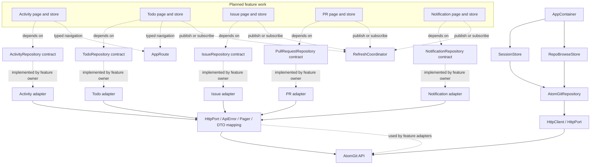

# Architecture and Roadmap

This document records the current design, what is implemented, and the next work items for the AtomGit HarmonyOS client. Update the status here when implementation or API verification changes the design.

## Scope

The app is developed by feature ownership. Each feature owner implements the repository port for their feature and injects that port into its stores or view models. Shared code provides stable types and rules; it does not require one repository class to implement every feature.

The current collaboration scope is Activity, Todo, Issue, Pull Request, and Notifications. The existing session and repository-browsing flow remains in `AtomGitRepository`.

## Current Architecture

Solid lines show implemented runtime paths. Dotted lines show declared contracts or planned feature wiring and adapters that remain to be implemented.

## Design Rules

- A page or store depends on the narrowest port it needs, such as `IssueRepository` or `TodoRepository`.
- Each feature owner implements their port in a feature adapter. Do not add all feature methods to `AtomGitRepository`.
- Adapters translate API DTOs into app entities, use `PageRequest` and `Page<T>` for paginated operations, and surface failures as `ApiError`.
- Shared DTO/entity types are added only when they are genuinely shared. Endpoint-only payload details can remain beside the adapter.
- Mutations publish refresh events only after the remote operation succeeds. Subscribers filter by account and feature domain.
- Routes use `AppRoute` factories and shared references such as `RepositoryItemRef`; route registration and page navigation are wired by the feature owner.

## Implementation Status

| Area | Status | Current boundary |
| --- | --- | --- |
| HTTP transport and cancellation | Implemented | `HttpClient` implements `HttpPort`; ports depend on `CancellationSignal` rather than the concrete client. |
| Error representation | Implemented | `ApiError` normalizes transport and HTTP failures. New adapters must preserve this type. |
| Pagination primitives | Implemented | Offset and cursor request types, `Page<T>`, continuation checks, and legacy `PagingState` are available. |
| Existing session/repository adapter | Implemented | `AtomGitRepository` serves current user, mine, repository browsing, and check runs. |
| Collaboration ports | Contract only | Activity, Todo, Issue, PR, and Notification interfaces are declared in `repository/Ports.ets`; no collaboration adapter implements them yet. |
| Collaboration DTOs and entities | Contract fixture | Fields follow the AtomGit payloads recorded in the project research baseline (`atomgit-cli` `138a070`); the notification, activity, pull request file, approval readback, comment, and issue detail shapes are pinned by `entry/src/test/CollaborationContract.test.ets`. Endpoint-specific mapping and live payload validation remain feature work. |
| Typed routes | Foundation implemented | Route factories exist; the app route registry and feature page callers are not wired to them yet. |
| Refresh events | Foundation implemented | In-process publish/subscribe and account/domain filters exist; feature mutations and stores are not connected. |
| Application wiring | Partial | `AppContainer` currently wires the existing `coreRepository`, session, repository browsing, and refresh coordinator. Feature adapters will be added as owners implement them. |

The collaboration contracts have no live (`L`/`W`) verification yet. Adapters must
compare the recorded fixtures with real responses and update both together; a field that
is absent from the fixtures is not a contract guarantee.

## Roadmap and Issue Drafts

The following issues are tracked in dependency order. Update their status here as work progresses.

### 1. Wire feature-specific repositories into application composition — [Issue #5](https://github.com/hust-open-atom-club/AtomGit-mobile4Harmony/issues/5)

**Goal:** Add feature adapters to `AppContainer` as they become available without creating a monolithic `AppRepository`.

**Acceptance criteria:** Each page/store receives only its required port; existing session and repository browsing continue to use `coreRepository`; no adapter is registered before it has a real implementation.

### 2. Verify and implement the Activity API adapter — [Issue #6](https://github.com/hust-open-atom-club/AtomGit-mobile4Harmony/issues/6)

**Goal:** Implement personal and repository activity reads against verified AtomGit endpoints and payloads.

**Acceptance criteria:** API fixtures document representative responses; DTO-to-entity mapping is covered; offset/cursor continuation is correct; failures preserve `ApiError`; the adapter implements only `ActivityRepository`.

### 3. Verify and implement Todo list API adapters — [Issue #7](https://github.com/hust-open-atom-club/AtomGit-mobile4Harmony/issues/7)

**Goal:** Implement assigned issues, created issues, and pull request todo scopes.

**Acceptance criteria:** Each scope maps to a verified API query; pagination and empty results behave consistently; returned items carry stable `RepositoryItemRef` values; the adapter implements `TodoRepository`.

### 4. Implement Issue detail and comment operations — [Issue #8](https://github.com/hust-open-atom-club/AtomGit-mobile4Harmony/issues/8)

**Goal:** Implement Issue detail reads, paginated comments, and comment creation.

**Acceptance criteria:** Detail and comment payloads have fixtures; write errors retain useful `ApiError` kinds; successful comment creation can trigger a scoped refresh; Issue status mutations are added to the port only if the agreed product flow requires them.

### 5. Implement Pull Request detail, diff, comment, and approval operations — [Issue #9](https://github.com/hust-open-atom-club/AtomGit-mobile4Harmony/issues/9)

**Goal:** Implement PR detail, comments, changed files/diffs, and approval.

**Acceptance criteria:** PR/Issue identity is not inferred from an unsafe untyped payload; file patches and missing patches are handled; approval errors are surfaced; a successful approval emits the agreed refresh event.

### 6. Implement Notification reads and mark-as-read — [Issue #10](https://github.com/hust-open-atom-club/AtomGit-mobile4Harmony/issues/10)

**Goal:** Implement notification list pagination, unread state, and mark-as-read.

**Acceptance criteria:** Notification targets map to typed routes; read state updates only after server success; account and repository scoping are preserved.

### 7. Connect refresh events to Todo and related feature stores — [Issue #11](https://github.com/hust-open-atom-club/AtomGit-mobile4Harmony/issues/11)

**Goal:** Refresh affected lists after comments, approvals, notification reads, and any supported Issue state changes.

**Acceptance criteria:** Subscribers filter by account/domain/resource; unrelated lists do not reload; listeners unsubscribe with store/page lifecycle; one listener failure does not prevent other listeners from receiving an event and is logged.

### 8. Register typed routes and migrate feature navigation — [Issue #12](https://github.com/hust-open-atom-club/AtomGit-mobile4Harmony/issues/12)

**Goal:** Connect `AppRoute` factories to the HarmonyOS route registry and replace stringly typed feature navigation.

**Acceptance criteria:** Activity, Todo, Issue, PR, and Notification targets navigate using typed params; invalid route/parameter combinations are not representable at call sites; route restoration is covered where supported.

### 9. Add collaboration adapter and contract tests — [Issue #13](https://github.com/hust-open-atom-club/AtomGit-mobile4Harmony/issues/13)

**Goal:** Protect paging, mapping, errors, cancellation, routing, and refresh behavior as feature adapters are added.

**Acceptance criteria:** Each adapter has successful, malformed-payload, API-error, cancellation, and pagination cases; refresh tests cover filtering, unsubscribe, and listener failures; tests run in the DevEco Hypium suite.

## Updating This Document

When work lands, update the status table and diagram so implemented paths are solid and pending paths remain dotted. Record verified API behavior with fixture or test references rather than assumptions.
